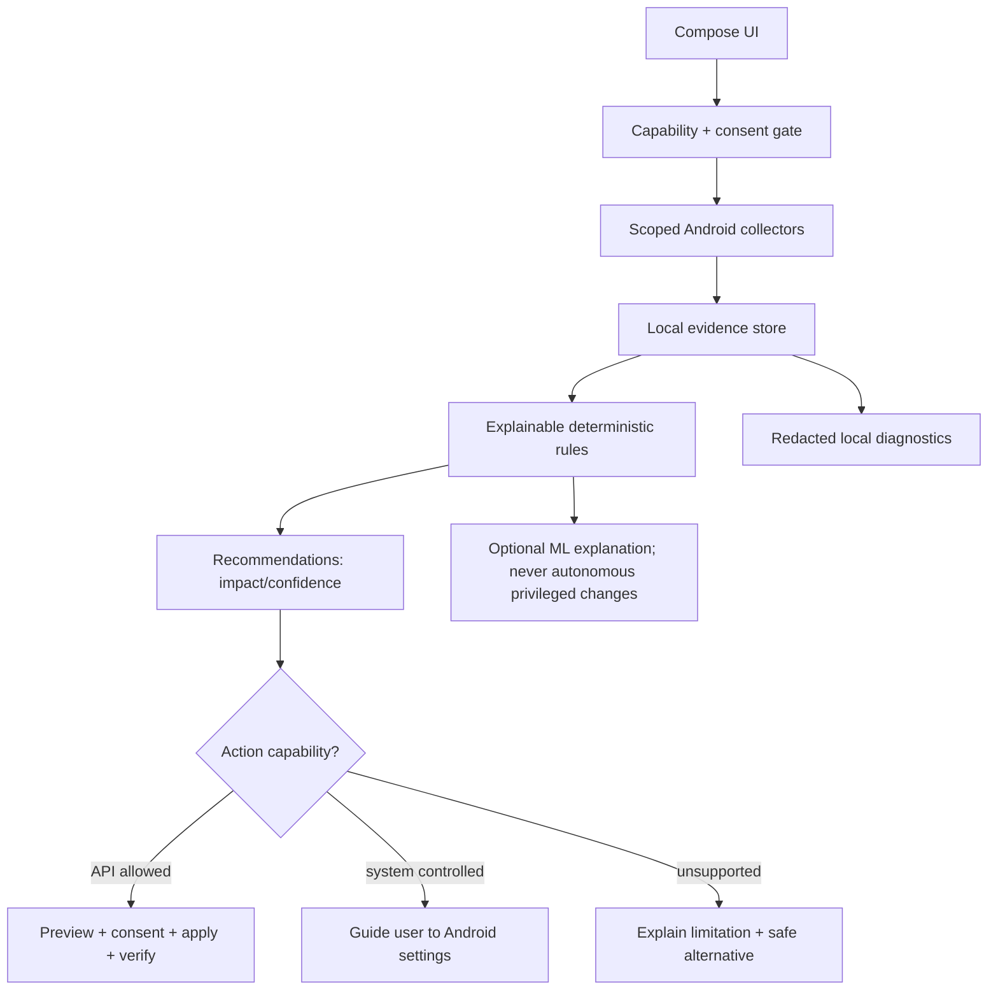

# P0 Architecture and milestone plan

Status: target design, **not yet implemented**. Source of truth for full requirements: [Roadmap Issue #1](https://github.com/SvenKulessa/AI-DeviceCare/issues/1).

## Two Android products, one codebase

| App | User | Commercial scope | Distinguishing experience |
| --- | --- | --- | --- |
| AI-DeviceCare | Individual | Free, Starter €3.99, Pro €6.49, Elite €14.79 | Local security, device/battery health, privacy and guided remediation |
| AI-DeviceCare+ | Managed business customers | Enterprise €29, Business Pro €59, Business Enterprise €129 | Authorized organization enrollment, multi-device posture, audit/export, fleet controls and role-based access |

Monthly billing is an **unconfirmed assumption**. Business device/seat limits, taxes, cost of goods, licensing and Play subscription configuration require explicit decisions. Product names and two-store-listing policy must pass store review. AI-DeviceCare+ must offer material, differentiated value; do not ship a second near-identical consumer app.

## Single repository and Gradle project folder

The **existing repository root** is the only Android project directory (`AI-DeviceCare/`). Both app modules and all shared feature/core modules live beneath it and are declared in one root `settings.gradle.kts`. Never create a nested standalone `apps/*/settings.gradle.kts`, a separate repository for the second app, or a redundant `AI-DeviceCare/AI-DeviceCare/` folder. See [Governance-as-Code and Capital-AI skill provenance](GOVERNANCE-AS-CODE.md).

## Proposed Gradle module graph (not yet created)

```text
apps/devicecare             consumer application (distinct applicationId)
apps/devicecare-plus        business application (distinct applicationId)
core/platform               Android capability discovery and permissions
core/model                  evidence, finding, capability and action contracts
core/storage                local-first encrypted/retained settings and evidence
core/ui                     design system, accessibility, localization
core/logging                structured, capped, redactable diagnostics
core/billing                contract only; per-app Play Billing adapters
feature/permissions         granted/declared app permission audit
feature/battery             BatteryManager supported signals and trends
feature/diagnostics         safe troubleshooting and post-action rechecks
feature/cleaner             user-owned/authorized storage cleanup
feature/malware             future validated rules and APK/static analysis
feature/network             future single VpnService DNS/firewall/VPN modes
feature/fleet               future authorized enterprise enrollment/management
```

### Data and actions



Evidence contract minimum: `findingId`, `moduleId`, `observedAt`, `signal`, `source`, `apiLevel`, `confidence`, `risk`, `limitations`, `recommendedActions`. Logging contract minimum: timestamp, severity, module, event, diagnostic reference, retention limit and redaction classification. No credentials, message content, raw VPN traffic or private files in logs.

## Release gates
- **M0 (foundation, internal only):** project structure, manifest minima, CI, dependency verification, governance, Android device/API support policy.
- **M1 (first store submission):** safe app/permission posture (where allowed), battery/charging summaries, diagnostics, local logs, safe/limited cleaner and Free/Starter entitlements; privacy disclosures, Play tests and approved billing.
- **M2 Pro:** tested malware/static scanning, signed rule supply-chain, transparent false positives and validated reports.
- **M3 Elite:** integrated DNS/privacy filtering and optional remote VPN with licensing/Play and leak-test gates; cap battery drain.
- **M4 AI-DeviceCare+:** business-specific enrollment, tenant isolation, organizational dashboard, role-based policy and proper enterprise rights.
- **M5 Business expansion:** per-seat/device contracts, policy workflows, enterprise-grade export, support and SSO if economics support them.

Every milestone ships independently; no premium feature advertised as active until functioning and supported. Release eligibility is distinct from successful CI. Consumer M1 must not depend on future antivirus, remote VPN or business capabilities.

## Decision log — initial assumptions
- Android first; no root, no ADB, no Accessibility automation.
- Kotlin + Jetpack Compose; version choices resolved in step 2 after checking supported Android Gradle Plugin/Kotlin and JDK compatibility.
- On-device-first storage and decision logic; optional remote processing by granular consent.
- No high-risk Android/Google Play permission in the M0 manifest.
- Two app IDs but code shared. Business app not published until it is functionally differentiated and approved.
