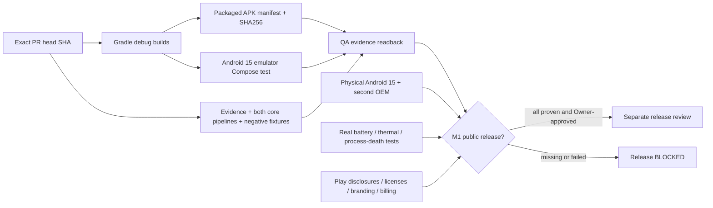

# Issue #5 — Android 15 P0.3/M1 QA: reproducible evidence and remaining manual checks

**Status:** IN_PROGRESS. This document is a test plan and evidence ledger, not a Play release approval.
**Source branch:** `feature/m1-battery-permission-evidence` / [PR #4](https://github.com/SvenKulessa/AI-DeviceCare/pull/4).
**Authority:** root `AGENTS.md`; core QA and core device scoring remain independently versioned and tested.
**Date:** 2026-11-06.
**Issue:** https://github.com/SvenKulessa/AI-DeviceCare/issues/5

## Automated no-device / Android 15 emulator evidence

| Gate | How executed | Meaning | Cannot prove |
|---|---|---|---|
| Versioned privacy contract | `:core:evidence:testDebugUnitTest`, negative tests for raw package/user/device strings, value bounds, expiry, invalid scope | bounded and typed in-memory observation metadata | no device-runtime access on an OEM |
| Battery mapper | `:features:battery:testDebugUnitTest` | missing/invalid level/status and temperature not treated as healthy | accuracy of OEM battery sensors |
| Permissions mapper | `:features:permissions:testDebugUnitTest` | visible-only scope, 250-sample flag, unknown permissions | coverage of full device inventory |
| Independent scoring vs quality | `:core:quality:testDebugUnitTest :core:scoring:testDebugUnitTest` | QA cannot assign device risk; no calibrated real score; unverified = `NOT_ASSESSABLE` | actual malware or device risk |
| Packaged APK manifest | `node --test scripts/verify-apk-policy.test.mjs && node scripts/verify-apk-policy.mjs` after both APK builds | `apkanalyzer` reads binary XML, `aapt2` reads packaged effective permission list; compare both application IDs, demand 0 permissions, no services/providers/receivers, one launcher, backup=false and targetSdk>=35; SHA-256 bound to commit | actual Play AAB output or dynamic runtime monitoring |
| Accessibility / UI | Android 15 API 35 emulator `:apps:devicecare:connectedDebugAndroidTest` | Compose semantics, button accessible, no scan on opening, explicit tap starts scan and no invented risk score | real TalkBack, OEM layout, font scale and motor/vision user testing |
| Passive CPU/runtime overhead | On click, UI shows monotonic elapsed ms and process CPU ms measured across both collectors (no persistence) | a reproducible informational per-session sample | power draw, mAh, thermal effect or battery lifetime. Never extrapolate CPU time into energy cost |
| Android standard CI | `.github/workflows/android-p0.yml` | security/license/secret scans, both apps built and linted; package policy, artifact hashes | production signing, release compliance, actual OEM sensor readings |

Both app APKs are **internal debug artifacts**; no network permission is requested. Debuggable does not imply a production release.
A pass for an Android 15 **emulator** means a test was run on a simulated API-35 device, not an ordinary Android-15/OEM device; cloud CI may lack Android-emulator KVM. Failed/incomplete jobs remain **NOT_PROVEN**, not PASS.

## Evidence dependency / fault graph



## Manual test instructions — must be performed on physical device

Record only device model family/OEM, Android API/patch month, the exact commit SHA, test pass/fail, short redacted screenshots and duration. **Never upload package lists, app names, message contents, Android IDs or verbose bugreports**.

1. **No ADB, no root, no special access:** install the exact SHA-matched internal debug APK using the supported owner-approved installation method. Confirm no scan automatically runs before the button.
2. **Battery reading:** compare percent to system battery; repeat while charging/unplugged. Check `GOOD` is Android platform health *state*, not capacity %, and that omitted temperature/health returns `UNSUPPORTED`. Report unavailable OEM features as such.
3. **App/package visibility:** compare displayed count only to OS context; it is deliberately *not* a full inventory. Check `sample_truncated`, confirm no raw package IDs visible or shared.
4. **Android 15 accessibility:** enable TalkBack manually. Validate title/section headings, one readable scan button, announcement of result updates, focus order, 200% display/font scale, portrait/landscape, light/dark where supported, 320dp width and scroll behavior. Disable/enable TalkBack as needed without app permissions.
5. **Cancellation and process death:** tap scan, rotate, background and force close. Reopen and confirm previous scan does not persist, no service remains, no stale diagnosis appears.
6. **Power / CPU and thermal:** run 10 one-shot scans separated by ≥30 s and compare UI elapsed and process CPU ms; measure actual device battery drain/thermal relative to baseline across repeatable sessions with same settings. Don't claim mAh estimates from `Process.getElapsedCpuTime()`; avoid deep battery drain testing.
7. **Security:** review Android Settings > Apps > AI-DeviceCare > Permissions; no location, contacts, notification, files, network VPN, Accessibility, usage access or QUERY_ALL_PACKAGES declarations. The app makes no system changes.
8. **Error pathways:** compare different OEM battery properties, false/absent broadcast, no visible packages if possible, deny via OS where applicable, interrupted scan. Expected result is explicit unavailable status, never a healthy risk score.

### Evidence table (to fill after tests)

| Test | Device / API | Outcome | Evidence | Blocking? |
|---|---|---|---|---|
| Android 15 physical battery & charging | NOT_TESTED | NOT_PROVEN | none | yes for M1 release |
| Android 15 physical package visibility | NOT_TESTED | NOT_PROVEN | none | yes for M1 release |
| OEM second device | NOT_TESTED | NOT_PROVEN | none | recommended, assess before release |
| TalkBack / fonts / rotation / process death | NOT_TESTED | NOT_PROVEN | none | yes for M1 release |
| Real power/thermal overhead | NOT_TESTED | NOT_PROVEN | none | yes for battery optimization claims |
| Production signed AAB & store policy | NOT_TESTED | NOT_PROVEN | none | yes for Play release |

## Prioritized remediation / evidence trace

| Priority | Known gap | Correction | Status |
|---|---|---|---|
| P0 | source-manifest-only inspection | validate both **packaged APKs** with `apkanalyzer` and `aapt2`, add negative tamper cases and CI artifact JSON | implementation added in PR #4; verify CI |
| P0 | observation contract accepted free-form PII | allowlist fixed metrics with bounds, max TTL, collector scope, test package names and device IDs | implementation added in PR #4; verify CI |
| P1 | Android 15 UI/consent not exercised | Compose UI instrumentation on API 35 emulator, manual TalkBack and real-device follow-up | emulator CI added; no physical claim |
| P1 | energy effect unknown | show bounded runtime and process-CPU ms per explicit scan; real device profiling deferred to release gate | informational only |
| P2 | no production APK/AAB proof | separate signing, AAB manifest, Play Billing, privacy declaration and full permissions review | blocked/out of this PR |

## Runbook / commands

```sh
node scripts/validate-governance.mjs
node --test scripts/validate-governance.test.mjs scripts/verify-apk-policy.test.mjs
gradle --no-daemon :core:evidence:testDebugUnitTest :core:quality:testDebugUnitTest :core:scoring:testDebugUnitTest :features:battery:testDebugUnitTest :features:permissions:testDebugUnitTest
gradle --no-daemon :apps:devicecare:assembleDebug :apps:devicecare-plus:assembleDebug :apps:devicecare:lintDebug :apps:devicecare-plus:lintDebug
node scripts/verify-apk-policy.mjs
# Android 15 emulator with an installed API-35 image:
gradle --no-daemon :apps:devicecare:connectedDebugAndroidTest
```

GitHub workflows: `.github/workflows/android-p0.yml` and `.github/workflows/android15-emulator-qa.yml`.
The action is pinned to `reactivecircus/android-emulator-runner@e89f39f1abbbd05b1113a29cf4db69e7540cae5a` (v2.37.0). No external paid service, new Supabase/Stripe resource, automatic Play release or elevated Android permission is introduced.

## Primary technical references

- https://developer.android.com/tools/apkanalyzer — actual APK merged manifest and effective permissions
- https://developer.android.com/tools/aapt2 — binary APK manifest examination
- https://mas.owasp.org/MASTG/techniques/android/MASTG-TECH-0141/ — merged-manifest inspection
- https://developer.android.com/develop/ui/compose/accessibility/testing — Compose semantics vs TalkBack manual testing
- https://developer.android.com/topic/performance/benchmarking/macrobenchmark-overview — do not treat emulator CPU timings as real device energy metrics
