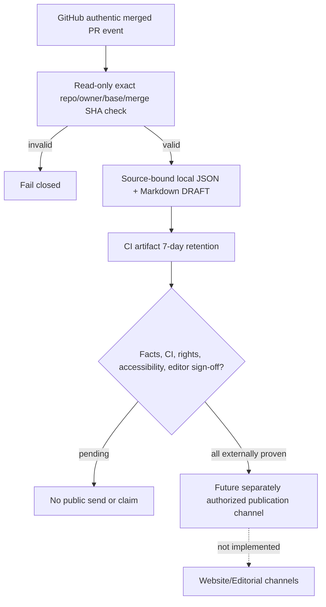

# Evidence-to-Editorial MVP — GitHub-native, draft-only (Issue #3)

**Status:** IMPLEMENTED_SOURCE_ONLY / NO PUBLICATION AUTHORITY / CI REQUIRED.
**Repository policy authority:** only root `AGENTS.md`.
**Scope:** P0/M0 low-cost prototype to prepare for a later M1 technical editorial campaign. No realtime provider service, queue, Supabase database, publishing token, Capital-AI social-network connection or NATS deployment.

## Audit provenance and safe reuse

Patterns **adapted**, not imported verbatim:
- Capital-AI [social-release-candidate.mjs](https://github.com/SvenKulessa/Capital-AI/blob/main/scripts/growth/social-release-candidate.mjs), source commit SHA `0d158b7064b788406d48df05c3aa77a30a09ccd2`: strict canonical repo identity, merge SHA, facts vs publication claims.
- Capital-AI [pr-merge-social-batch.mjs](https://github.com/SvenKulessa/Capital-AI/blob/main/scripts/growth/pr-merge-social-batch.mjs), source file SHA `7175b526b18c801f71edf8a72b5b4b22e3c53f3d`: source-bound DRAFT_NOT_PUBLISHED and no worker/publisher authority.
- Capital-AI [merge worker architecture](https://github.com/SvenKulessa/Capital-AI/blob/main/docs/growth/PR-MERGE-SOCIAL-PARALLEL-WORKERS-20261015.md): do **not** enable external OpenAI/Firecrawl or provider API workers without an explicit rights, privacy and spending review.
- Existing DeviceCare [campaign boundary](../GROWTH-CAMPAIGN-BOUNDARY.md): owner approval, human editor, no silent posting or bulk forum promotion.
- Patterns are reimplemented using Node built-ins only. No external code artifact, graphic, font, asset or market data was copied; commercial-brand and asset rights remain REVIEW_REQUIRED.

## Bounded design

- `.github/workflows/editorial-draft-only.yml` uses `pull_request` events with **contents:read** only. For open PRs it runs positive/negative contract tests. On an actual merged PR into `main`, it uses the GitHub-hosted event payload (no direct arbitrary external webhook receiver), checks fixed owner/repo IDs, PR base, merge SHA and merged state, then writes only short review artifacts. No new repository token or approval is granted.
- `scripts/growth/editorial-candidate.mjs`: deterministic `DEVICECARE_EDITORIAL_DRAFT@1` with fixed source URLs, sanitized title, canonical source digest, two draft channels (owned changelog and external editorial *pitch suggestion*, not submitted), redacted narrative.
- `scripts/growth/editorial-candidate.test.mjs`: valid source event, cross-repo and unmerged negatives, wrong base/owner, invalid SHA, prompt-injection/markup sanitization, no publish authorization and no cost path.
- Exact outcome always contains `state=DRAFT_ONLY`, `publication.approved=false`, `publishAllowed=false`, `providerCalls=0`, `externalSpendAllowed=false`. `ciReadback=NOT_PROVEN` until checked against a genuine GitHub Actions result. **Merge evidence is not product release evidence**. No calibrated risk score, no Android-15 real-device QA and no malware protection claim.
- `artifacts/editorial-drafts` is an ephemeral local output folder and GitHub CI artifact, not a publicly indexed webpage. Drafts are not posted into GitHub Discussions, X, journalists' inboxes or community forums.

## Why this is not an event streaming service

At this stage there is one post-merge event at a time. GitHub Actions supplies authenticated event delivery, artifact retention and CI visibility without per-project cloud compute or NATS/Kafka. If later event volume, retry and editorial multiworker requirements justify asynchronous processing, decide using measured throughput and costs; a dedicated signed-webhook ingress plus bounded durable inbox, idempotency, replay protection and DLQ must be scoped and tested *before* integration. No existing Capital-AI NATS market-data infrastructure is reactivated.

## Remaining acceptance gates and scope holds

| Gate | State | Reason |
|---|---|---|
| Offline generator + negative fixtures | IMPLEMENTED — CI evidence pending | GitHub Action must run on exact head |
| Genuine PR merged event exercise | NOT_PROVEN until a safe actual merge | Cannot forge CI receipts from static input |
| CI and mobile release SHA corroboration | NOT_PROVEN | Not performed by simple event parsing |
| Content factual/editorial approval | REVIEW_REQUIRED | Human editorial judgment and right of reply |
| Branding, image/music rights | REVIEW_REQUIRED | No Capital-AI or AI-DeviceCare asset copied |
| Android physical device claim | NOT_PROVEN | Issue #5 real-device QA still open |
| External providers and journalistic submission | BLOCKED | No approved account, channel rules or publish right |
| Paid OpenAI / Firecrawl / NATS streaming | DISABLED | No purchased API, extra service or runtime credential |

Rollback: revert only the draft workflow and its two Node files; no database, mobile module, installed app or external account is changed. Do not close Issue #3 until explicitly accepted future campaign criteria are met. A technical PR merge is not authorization to publish or proof of commercially distributable media rights.
